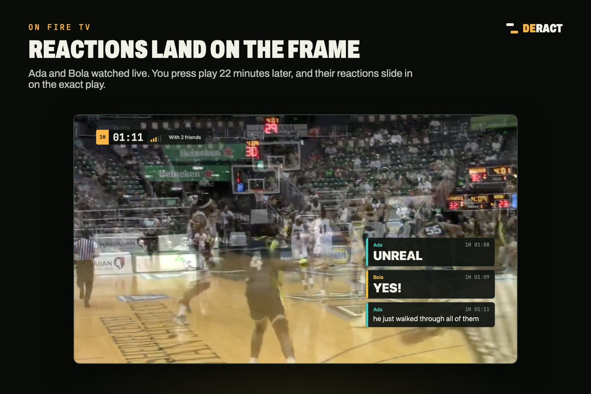
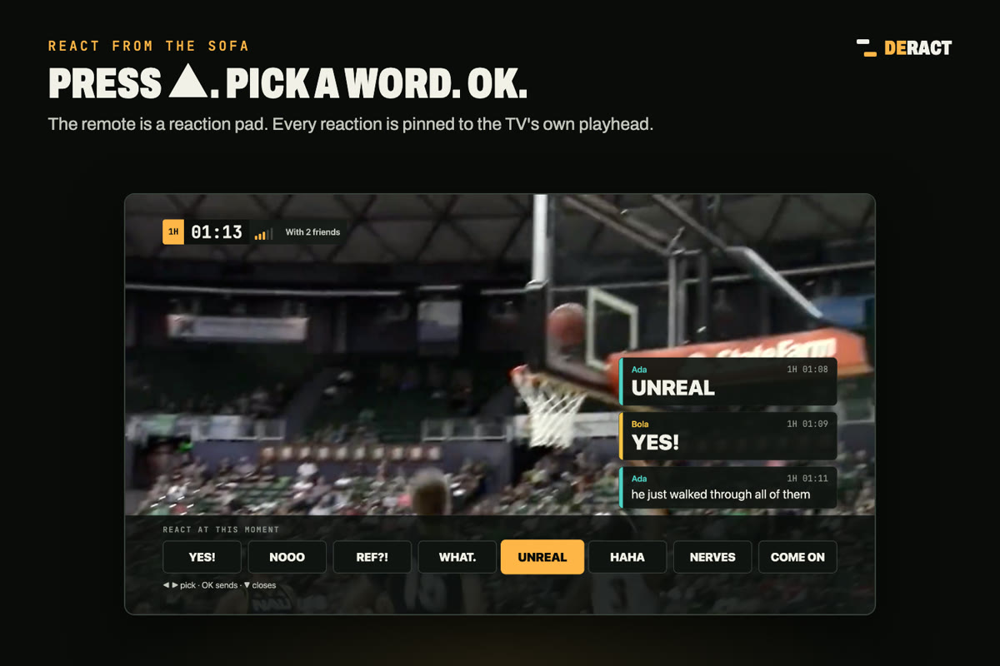
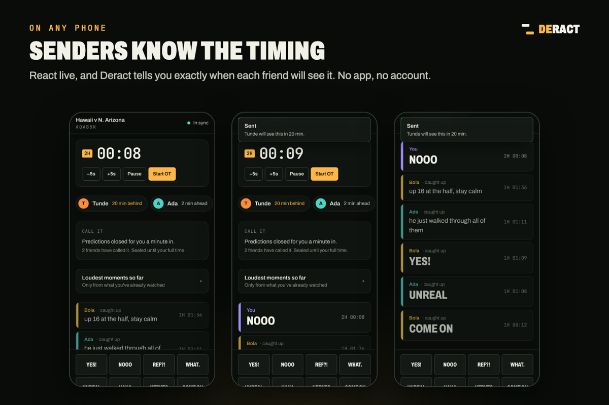
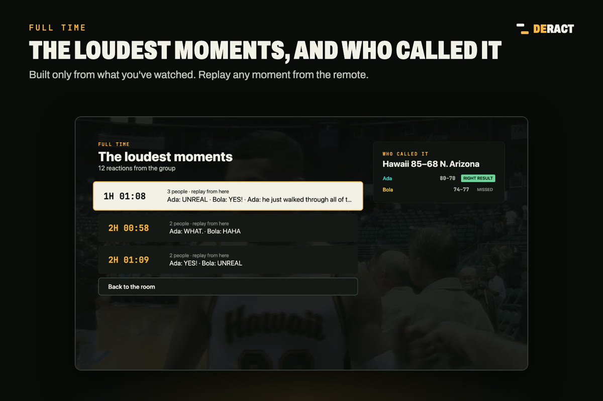
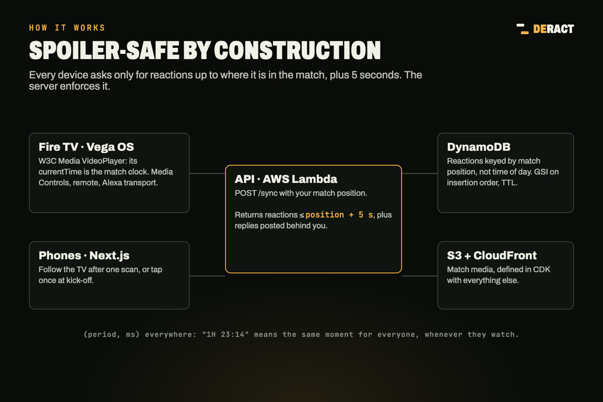

# Deract

**Your group chat, on your game clock.**

[](https://github.com/successaje/delayed-reaction/actions/workflows/ci.yml)
[](LICENSE)
[](https://delayed-reaction.vercel.app)
[](https://youtu.be/p7-DKxAX30M)


[](https://youtu.be/p7-DKxAX30M)

**▶ [Watch the 2-minute demo](https://youtu.be/p7-DKxAX30M)**

Watch the match an hour late and still watch it with your friends. Deract (short for *delayed reaction*) pins every reaction to the **match clock** instead of the wall clock, so it reaches each person at the moment it happened in the game, and never before.

It's a **Fire TV app (Vega OS)**, a **phone companion** that works in any browser, and a **serverless backend on AWS**.

> Built for Amazon's *Build, Ship, Shape* hackathon, Fire TV track.
>
> **Demo video:** https://youtu.be/p7-DKxAX30M · **Live:** https://delayed-reaction.vercel.app · **Friction log:** [docs/FRICTION_LOG.md](docs/FRICTION_LOG.md)

---

## The problem

Live sport is social, but most people can't watch live: bedtime, shifts, time zones. Watching late means muting the group chat, because the friends who make the game fun are also the fastest way to spoil it.

And "live" isn't even live. Some 2026 Super Bowl streams ran up to 62 seconds behind the field (Stats Perform), while 77% of fans do something else sports-related as they watch: chats, feeds, scores (Deloitte, 2023). The chat is always ahead of somebody.

## What it does



- **Reactions land on the frame.** Friends react live; you press play later. Each reaction slides in as a broadcast-style lower-third at the exact match moment it was sent.
- **Pause, rewind, skip.** On Fire TV the video playhead *is* the clock. Pause and reactions wait, rewind and they replay, skip ahead and they're filed away instead of flooding the screen.
- **React from the sofa.** Press ▲ on the remote, pick a word, press OK. Or scan the TV's QR code and your phone becomes a reaction pad already synced to the TV.
- **Senders know the timing.** React live and you're told exactly when each friend will see it: *"Tunde will see this in 38 min."*
- **Replies from behind.** Reactions from someone watching even later travel backwards to you, marked *caught up*.
- **Call it.** Everyone predicts the score before kick-off; predictions stay sealed until each person reaches full time.
- **Crowd sound.** When several friends react together, the room hears a cheer or a groan.
- **Full-time recap.** The group's loudest moments, replayable from the remote and shareable as a link.
- **Any sport's clock.** Football halves, basketball quarters, college halves: positions are `(period, time into period)`.

You see *that* friends are ahead of you ("Ada · 38 min ahead"), never *what* they've seen.

| React from the remote | Phone companion | Full time |
|---|---|---|
|  |  |  |

## Try it in 2 minutes

**No Fire TV needed: two browser windows.**
1. Window A: open https://delayed-reaction.vercel.app/start, create a room, tap **Kick-off**, wait about 20 seconds, then tap **NOOO**.
2. Window B (or a phone): open the room link, join, and tap **Kick-off** now, so you're about 20 seconds behind.
3. About 20 seconds later on B's clock, A's NOOO arrives. Never before. Try Pause and the −5s/+5s buttons.

**On Fire TV (Vega OS):** build with the Vega SDK (`cd apps/vega && yarn build`) and install on the Vega Virtual Device:

```bash
vega run-app build/aarch64-release/vega_aarch64.vpkg com.successaje.delayedreaction.main
```

The app talks to the production API, so it works out of the box. Pick a match, then fill the room with two friends who "already watched it live":

```bash
node scripts/seed-demo.mjs <ROOM_CODE>
```

## How it works

```
 phone (live)                        API                             Fire TV (38 min late)
 tap "NOOO" at 1H 23:14  ──POST──▶  reactions sorted by (period, ms)
                                                       ◀──POST sync {position, cursor}──
                                     serves only ≤ position + 5 s
                                                       ──────────────▶  released when the
                                                                         playhead crosses 1H 23:14
```

- **Match positions, not timestamps.** A reaction is stored at `(period, ms into period)`. Each viewer re-anchors at every period start, so ads and half-time never drift anyone into the future.
- **Three clock sources:**
  - `player`: the Fire TV video playhead;
  - `manual`: tap at kick-off, with pause and ±5 s nudges;
  - `linked`: a phone that scanned the TV's QR code and follows the TV's clock.
- **The spoiler invariant, enforced by the server.** A device can only receive reactions up to its own position plus a 5-second prefetch window (`clampUntil` in `packages/core`).
- **Pull, not push.** One `sync` request per tick reports the viewer's position (for presence) and pulls whatever is newly within reach. The server stays stateless, so it runs on Lambda.
- **Replies from behind.** The sync cursor tracks both match position and insertion order, so a reaction posted *behind* you by someone watching even later still reaches you.



More detail: [docs/ARCHITECTURE.md](docs/ARCHITECTURE.md) and [docs/PRODUCT.md](docs/PRODUCT.md).

## Amazon technology used

| Technology | Where | How |
|---|---|---|
| **Vega OS** (React Native for Fire TV) | `apps/vega`, `packages/tv-ui` | The TV app. Platform code in `*.vega.tsx`, bundled by Metro for `kepler` |
| **W3C Media** (`@amazon-devices/react-native-w3cmedia`) | `packages/tv-ui/src/player/VideoSurface.vega.tsx` | `VideoPlayer` + `KeplerVideoSurfaceView`. Its `currentTime` drives the match clock |
| **Vega Media Controls** (`KeplerMediaControlHandler`, `IMediaPlaybackServer`) | `packages/tv-ui/src/player/media-controls.vega.ts` | Remote media keys, the system UI and Alexa transport commands drive the same player the match clock reads; "start over" returns to kick-off |
| **Vega remote input** (`TVEventHandler`) | `packages/tv-ui/src/remote/source.vega.ts` | D-pad, select, back and play/pause, routed into spatial focus navigation |
| **AsyncStorage for Vega** | `apps/vega/src/App.tsx` | Remembers rooms on the TV |
| **AWS Lambda + API Gateway (HTTP API)** | `services/api/src/lambda.ts`, `infra/` | The API |
| **Amazon DynamoDB** | `services/api/src/store/dynamo.ts` | Single table: reactions range-queried by match position, GSI on insertion order, TTL |
| **Amazon S3 + CloudFront** | `infra/lib/stack.ts` | Match media delivery |
| **AWS CDK** | `infra/` | All infrastructure as code |

## What's next: Alexa

Deract is made for voice. At the big moment nobody wants to reach for a phone; you just shout at the TV.

- **"Alexa, NOOO!"** heard on your Fire TV, pinned to *your* TV's match clock, delivered to every friend at that same moment in their own match.
- **Everyone talks to Alexa in their own living room, at their own time, and it all syncs to one game clock.**
- **Alexa+ as the group's memory, spoiler-safe:** "Alexa, what did everyone say about that penalty?" answers only from what you've already watched.
- **It already listens:** "Alexa, pause" and "Alexa, rewind" move Deract's match clock today, through Vega Media Controls.

Also next: an SDK so any sports app on Fire TV can add asynchronous co-watching, and official game-clock sync from sports data.

## Repository

```
packages/
  core/      Domain: match positions, clocks, spoiler gate, reaction timeline, API schemas (zod)
  client/    Typed API client, TimelineSync engine, playheads, device session store, React hooks
  tv-ui/     Fire TV screens and components (React Native), shared by Vega and the browser build
apps/
  vega/      Vega OS app shell (RN 0.72, manifest.toml, Metro)
  tv-web/    The TV app in a browser via React Native Web (development and demos)
  web/       Next.js: landing page and phone companion (/r/:code)
services/
  api/       Hono HTTP API: Node server locally, Lambda in production; memory or DynamoDB store
infra/       AWS CDK stack
docs/        Product model, architecture, deployment, friction log, build log
scripts/     Demo media builders (freely licensed footage from Wikimedia Commons)
```

## Local development

Requirements: Node 22+, Corepack (Yarn 4), and ffmpeg for the demo media.

```bash
corepack enable
yarn install
scripts/fetch-demo-media.sh   # builds the two demo matches into apps/web/public/media

yarn dev:api    # API on http://localhost:8787 (in-memory store)
yarn dev:web    # landing page and phone companion on http://localhost:3000
yarn dev:tv     # the Fire TV app in a browser on http://localhost:5173 (arrow keys, Enter, Esc, Space)
```

Try the loop:
1. In the TV app, start the demo match.
2. Open the lobby's join link on your phone (or another tab), choose **Follow Living room TV**, then press play on the TV.
3. React on the phone.

Then open the room in a second browser profile, join as someone watching on another screen, tap **Kick-off**, and react. When the TV reaches that moment, the reaction lands.

### Environment

| Variable | Where | Default |
|---|---|---|
| `NEXT_PUBLIC_API_URL` | `apps/web` | `http://localhost:8787` |
| `VITE_API_URL`, `VITE_WEB_URL` | `apps/tv-web` | `http://localhost:8787`, `http://localhost:3000` |
| `PORT`, `CORS_ORIGINS`, `MEDIA_BASE_URL`, `TABLE_NAME`, `DYNAMODB_ENDPOINT` | `services/api` | See `services/api/.env.example` |

## Testing

```bash
yarn test        # 89 tests: core, client, API (including DynamoDB via dynalite), and a Vega Metro bundle
yarn typecheck   # every workspace, including the Vega-only files
yarn build       # web, TV web build, Lambda bundle
```

Highlights:
- `packages/client/test/engine.test.ts` runs the 38-minutes-late scenario end to end against the real API with fake timers.
- `services/api/test/store.contract.test.ts` runs one contract against both the memory and DynamoDB stores.
- CI synthesizes the CDK stack and bundles the Vega app on every pull request.

## Deployment

See [docs/DEPLOYMENT.md](docs/DEPLOYMENT.md):
- AWS via CDK (DynamoDB, Lambda, HTTP API, CloudFront);
- Vercel for the web app;
- the Vega SDK for the `.vpkg`.

## Developer feedback

[docs/FRICTION_LOG.md](docs/FRICTION_LOG.md) records every Vega and tooling problem we hit, with workarounds and suggestions.

## Credits

Demo footage, both from Wikimedia Commons:
- the 2021 FIFA Beach Soccer World Cup final, filmed from the stands by **Voltmetro**, released under **CC0** ([source](https://commons.wikimedia.org/wiki/Category:2021_FIFA_Beach_Soccer_World_Cup_Final));
- Hawai'i v Northern Arizona men's basketball (19 November 2018), highlights by **Warrior Insider** under **CC BY 3.0** ([source](https://commons.wikimedia.org/wiki/File:Hawaii_Basketball_-_Highlights_From_Northern_Arizona_Game.webm)). The demo cut keeps only game action: the interviews and the opening stat montage are removed.

Crowd sounds: the cheer is from *Football Austria vs. Sweden* by Work With Sounds / Torsten Nilsson ([CC BY 4.0](https://commons.wikimedia.org/wiki/File:WWS_FootballAustriavs.Sweden.ogg)); the groan is *Ohhh ahhh* by starlite (public domain, via Wikimedia Commons).

## License

[MIT](LICENSE)
